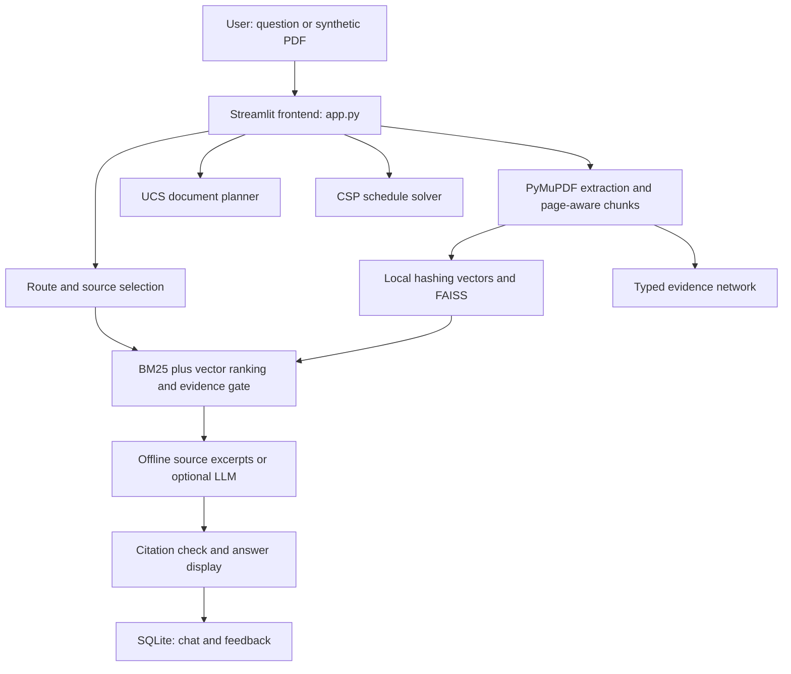

# MediGuide: Explainable Healthcare Document Assistance and Claim Preparation

End-semester project report content draft, revised 14 November 2026 for release 0.5.0-demo. Faculty formatting template and student details are pending. This report describes the implemented system, including its limitations.

## Abstract

Patients can struggle to understand medical reports, discharge instructions and insurance policies. MediGuide retrieves evidence from public medical references and synthetic user documents, then presents source-cited explanations. The prototype combines a Streamlit interface, PyMuPDF extraction, deterministic feature-hashing vectors, FAISS similarity search, BM25 ranking, an optional language-model interface and SQLite persistence. An inspectable semantic network represents evidence provenance. Uniform-cost search finds a least-effort document collection plan; a constraint-satisfaction solver schedules preparation tasks. These planning examples support human organization of paperwork and do not decide clinical treatment or claim eligibility. Tests and a small authored benchmark demonstrate functional behavior without establishing clinical validity.

## 1. Problem formulation

Medical and policy information is technical and distributed across documents. Users need to locate relevant statements, understand them, and identify documented follow-up or administrative steps. A generic chatbot may answer from unrelated background knowledge or invent details absent from a report.

**Problem statement:** Given a question, an appropriate knowledge route and optionally a selected document, retrieve relevant evidence and provide a concise explanation with source/page attribution; when evidence is inadequate, state the gap. For claim preparation, help users inspect a document-collection plan and a feasible schedule under explicit assumptions.

**Intended users:** students demonstrating patient-information assistance and users testing synthetic documents. The current application is a local single-computer prototype.

**Scope:** general education, document explanation, medication-label lookup, policy-clause navigation and paperwork planning. Diagnosis, personalized prescribing, claim approval and real patient deployment are outside the validated scope.

## 2. Objectives and success criteria

1. Extract text from selectable-text PDFs while retaining page numbers.
2. Retrieve route-appropriate evidence and attach citations to displayed claims.
3. Preserve conversational context and feedback in local storage.
4. Demonstrate explicit state-space search, semantic knowledge representation and CSP solving.
5. Test irrelevant-query rejection, document separation, updates and UI reruns.
6. Report retrieval performance and limitations with reproducible commands.

Success is demonstrated through passing functional tests, inspectable algorithm traces and a reproducible benchmark. It is not defined as universal medical correctness.

## 3. Intelligent system design



**Frontend:** Streamlit supplies navigation, upload widgets, chat, source previews, download controls, feedback and the AI methods lab. A rerun executes the page script again; session state keeps the active conversation.

**Backend:** Python modules perform extraction, retrieval, answer assembly, graph construction and planning. Frontend and backend run in the same Python application. There is no separate React client or FastAPI service.

**Storage:** route-specific JSON metadata and NumPy vectors persist the document index. FAISS performs in-memory inner-product search over normalized vectors. SQLite persists document audit metadata, messages and feedback. Raw uploaded PDF files are processed in memory; extracted chunks persist locally.

**Answer flow:** select route/document; check emergency/dosage rules; optionally incorporate the preceding question for a pronoun follow-up; retrieve; reject weak lexical matches; extract sentences or call the configured model; validate citation labels; display evidence; save history. Citation validation checks references, not entailment of every clinical assertion.

**Human interaction:** the user checks source text and changes selected documents, constraints or questions. The system supports understanding rather than autonomous clinical decisions.

**Contribution:** one application combines evidence-grounded healthcare explanation with policy preparation and transparent classical-AI planning. This is a project integration contribution, not a claim to invent new RAG algorithms.

## 4. Literature review and comparison

Focused review of primary sources checked on 11 November 2026. The newest included work is a 2026 preprint; publication status is distinguished from established conference work.

| Work | Approach and focus | Lesson for MediGuide | Difference from this implementation |
|---|---|---|---|
| Lewis et al., 2020, RAG [1] | Parametric generation combined with retrieved non-parametric knowledge | Separate knowledge retrieval from generation and retain provenance | MediGuide does not fine-tune a retriever/generator; default output is extractive |
| Xiong et al., 2024, MedRAG/MIRAGE [2] | Systematic medical QA evaluation across corpora, retrievers and LLMs | Retrieval choices and evaluation design matter | Their benchmark is much larger; our 18 authored cases cannot support cross-paper accuracy comparisons |
| Ngo et al., 2024, MedRGB [3] | Evaluates evidence sufficiency, integration and robustness to noisy/misleading retrieval | Include unsupported questions and avoid equating a citation with correctness | MediGuide has limited negative tests; a complete robustness benchmark remains future work |
| Li and Zhu, 2026, MRAG v2 preprint [4] | English/Chinese biomedical tasks and component evaluation, including readability concerns | Examine readability alongside retrieval quality | MediGuide is predominantly English and has no multilingual clinical validation |
| Proposed MediGuide | Source-filtered local retrieval, extractive/API answers, evidence graph, UCS and CSP for paperwork | Makes evidence and planning inspectable in a student project | Small corpus, local single-user design and no clinical validation |

These papers motivate design choices. We have not rerun their experiments, trained their models or demonstrated superior performance. The literature review summarizes stated methods and findings, not a meta-analysis.

## 5. State-space search

**Task:** collect the documents needed for a demonstration claim preparation goal.

**State:** a frozenset of available document identifiers, e.g. `{identity}`. **Initial state:** the documents selected by the user. **Goal test:** all required identifiers are a subset of the current state. **Actions:** collect a document or a bundle, with prerequisite documents and a nonnegative effort cost. **Transition:** union the provided documents with the current state when prerequisites hold.

Demo actions: discharge summary costs 2; itemized bill costs 2; a hospital bundle containing both costs 3; identity proof costs 1; claim form completion costs 1 and requires the other three documents. Costs are educational effort units, not measured time or insurer charges.

**Strategy:** uniform-cost search (Dijkstra over implicit states). A min-heap expands the frontier node with smallest accumulated cost. A best-cost dictionary rejects more expensive ways of reaching the same state. The implementation returns both the action plan and expanded-state trace.

**Justification:** BFS minimizes action count when costs are equal, which does not fit different effort costs. UCS minimizes total cost with nonnegative costs. A* would require a justified heuristic; UCS is simpler and sufficient for this small finite domain.

**Worked example:** initial `{identity}`. Request hospital bundle for cost 3, then complete claim form for cost 1. Total cost 4. Collecting the two papers separately costs 2+2+1=5. If bundle effort becomes 8, the solver switches to separate collection. Already-satisfied goals return cost 0; unreachable goals return no plan.

**Complexity:** for n document types, at most 2^n states. With V reachable states and E generated edges, heap-based graph search is approximately O((V+E) log V), excluding set-copy costs. The UI uses four document types; the general demo function caps the problem size. A least-cost plan is guaranteed only for the supplied action model and costs.

## 6. Knowledge representation

The implementation uses a typed semantic network of triples `(subject, relation, object)` plus node attributes. Types are Route, Document, Evidence and Concept. Relations are `contains`, `has_evidence` and `mentions`.

Example: `route:lab contains doc:lab:report.pdf`; that document `has_evidence` a chunk on page 2; the chunk `mentions concept:hemoglobin`. Evidence nodes retain page and source URL where available. Nodes and edges are deterministic and exportable as JSON.

This representation is appropriate for provenance inspection: a concept mention can be traced back to a page. Concept recognition uses a small explicit alias dictionary with word-boundary matching. A mention is not a causal relation, diagnosis or validated medical ontology. The graph is an explanation/inspection feature; current RAG ranking uses chunk text, not graph traversal. Graph construction is roughly O(C * A * L), where C is chunk count, A the small alias count and L chunk length.

## 7. Constraint satisfaction problem

The rubric offers CSP **or** fuzzy logic. MediGuide implements CSP and does not claim fuzzy membership functions.

**Variables:** collect hospital papers, collect identity proof, complete claim form, submit claim. **Domains:** allowed integer days from availability to the selected deadline. **Constraints:** exactly one day per task; hospital papers and identity proof strictly precede form completion; form completion strictly precedes submission; tasks per day do not exceed capacity; every day is within its domain.

**Solver:** recursive backtracking. For each unassigned variable, recompute values consistent with assigned tasks. Select the variable with minimum remaining values (MRV). Try days in ascending order, recurse, and undo assignments if necessary. An empty domain detects failure early. This is forward checking, not full arc consistency/AC-3.

Example: deadline day 5, papers available day 2, capacity 1. A feasible assignment is identity day 1, hospital papers day 2, form day 3, submission day 4. With all domains restricted to day 1 and strict precedence, the problem is unsatisfiable. The solver reports failure rather than silently dropping constraints.

Worst-case complexity is exponential, O(d^v) assignments for v variables and maximum domain size d, plus constraint-check overhead. MRV improves practical ordering but not the theoretical bound. This solver finds a feasible schedule, not a globally optimal schedule. Inputs describe a demo workflow and are not automatically inferred insurer deadlines.

## 8. AI and non-AI components

| Component | Classification | Actual implementation |
|---|---|---|
| UCS planner | Classical AI search | Min-heap, state transitions, goal test and cost pruning |
| CSP scheduler | Classical AI constraint reasoning | Backtracking with MRV and forward checking |
| Semantic network | Symbolic knowledge representation | Typed nodes, relations, provenance and dictionary mentions |
| Hybrid retrieval | Information retrieval / AI-supporting NLP | BM25 and similarity of deterministic hashing vectors |
| Offline answering | Heuristic extractive NLP | Relevant sentence selection, deduplication, citations |
| Optional API answerer | Generative AI when configured | External chat model over retrieved context; no local model training |
| Safety/dosage rules | Deterministic rules | Pattern-based checks; limited scope, not complete clinical safety |
| Streamlit, PyMuPDF, SQLite, exports | Non-AI software | UI, extraction, persistence and file delivery |

Hashing embeddings are engineered sparse-feature projections stored densely, not learned transformer embeddings. FAISS is a search library, not a language model. No neural network or genetic algorithm is trained in this project. LangChain is not imported; equivalent orchestration is explicit Python for readability.

## 9. Results and continuous evaluation

Latest verified run: 58 tests passed. Tests cover PDF/chunk search, normalization, emergency keyword behavior, screen reruns, guided questions, feedback, policy checklist, saved evaluation display, unsupported questions, source filtering, policy replacement, follow-up context, dosage clarification, UCS optimal-plan examples, unsatisfiable CSP cases, semantic-network provenance and interactive AI-lab execution. Additional checks cover question length, cross-document ambiguity, generated citation/number validation and history-storage failure recovery. Passing these tests does not establish clinical correctness.

Broader authored benchmark rerun on 14 November 2026: 18 questions, including 14 answerable and 4 unsupported cases, offline mode, K=3. Precision@3 = 38.10%; Recall@3 = 75.00%; Hit Rate@3 = 100%; citation-source relevance = 100%; citation label validity = 100%; correct abstention on four unsupported cases = 100%. Raw results: data/gold/final_review_2026_11_14.json. These are development cases, not an independent held-out clinical benchmark. Compared with the previous 45.24% precision and 85.71% recall, exact-topic preference improves citation-source relevance but reduces distinct relevant-page coverage. Do not describe this as improvement on every metric.

Precision counts distinct relevant source/page hits divided by requested K. Recall divides by all annotated relevant source/pages. Hit rate is a binary per-question retrieval success. Citation-source relevance checks whether a cited retrieved source/page is in the relevance annotation. Label validity checks that a cited index resolves. Neither is a measure of clinical claim entailment.

High hit rate with lower precision means the correct source appears but additional retrieval slots are not all distinct relevant pages. Duplicate chunks on the same page do not earn multiple retrieval hits. Multiple acceptable sources can make Recall@K lower even when at least one source is found. The negative subset is too small to imply reliable refusal across arbitrary questions.

Reproduce:

```powershell
python -m pytest -q
python -m mediguide.evaluation data/gold/broader_gold.json --k 3 --output data/gold/final_review_2026_11_14.json
```

Continuous evaluation procedure: add a regression case for each observed failure; run tests after code changes; save dated benchmark outputs; compare metrics and inspect individual answers. Earlier implementation issues included unrelated iron excerpts, malformed synthetic PDF dashes and UI reload behavior. Current fixes have regression tests, but no invented marks, faculty sign-offs or external validation are claimed.

## 10. Ethics, limitations and future work

Public references largely reflect US sources and English text. Insurance examples are fictional and cannot represent every country or policy. Dictionary aliases and lexical retrieval can miss paraphrases. Demographic nutritional tables must not become personal treatment recommendations. Pattern-based emergency checks can produce false positives and false negatives. Prompt instructions and citation checks reduce some errors but cannot eliminate hallucination.

The app is local and shared by route. It has no authenticated tenant isolation or encryption-at-rest implementation. Users must use synthetic documents. Optional API mode sends retrieved snippets and recent messages to the configured endpoint; assess that provider before using sensitive information. A human should inspect original sources and verify current effective dates. The default public snapshot is from September 2026, with a separately curated NIH iron reference from November 2026.

Future work: clinician- and policy-reviewed held-out data, better semantic embeddings, OCR, stronger entity normalization, authenticated isolated storage, structured claims extraction, evidence-entailment evaluation and broader language testing. These are explicitly future work, not implemented features.

## References

[1] Lewis et al. Retrieval-Augmented Generation for Knowledge-Intensive NLP Tasks. NeurIPS 2020. https://arxiv.org/abs/2005.11401

[2] Xiong, Jin, Lu and Zhang. Benchmarking Retrieval-Augmented Generation for Medicine. 2024. https://arxiv.org/abs/2402.13178

[3] Ngo et al. Comprehensive and Practical Evaluation of Retrieval-Augmented Generation Systems for Medical Question Answering. 2024 preprint. https://arxiv.org/abs/2411.09213

[4] Li and Zhu. MRAG: Benchmarking Retrieval-Augmented Generation for Bio-medicine. 2026 preprint, v2. https://arxiv.org/abs/2601.16503

[5] MedlinePlus Web Service documentation. https://medlineplus.gov/about/developers/webservices/

[6] openFDA Drug Label API. https://open.fda.gov/apis/drug/label/

[7] NIH Office of Dietary Supplements, Iron consumer fact sheet. https://ods.od.nih.gov/factsheets/Iron-Consumer/
